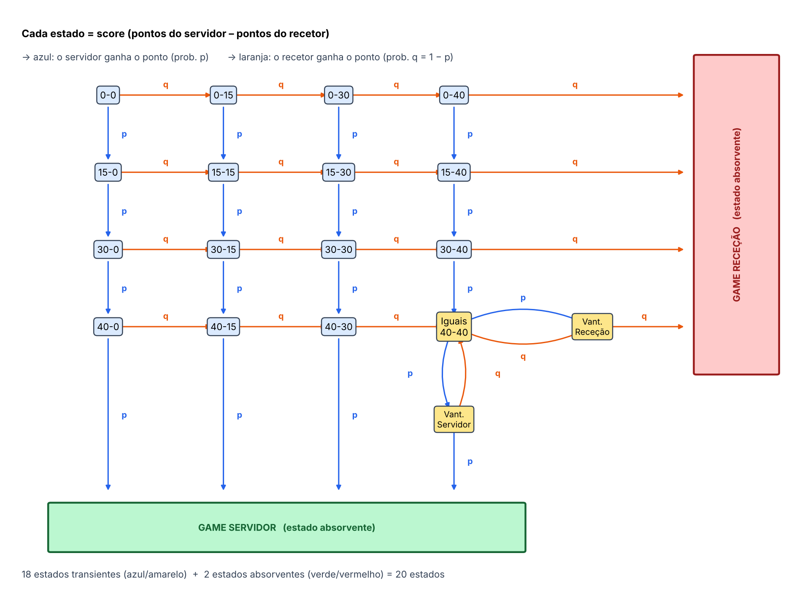
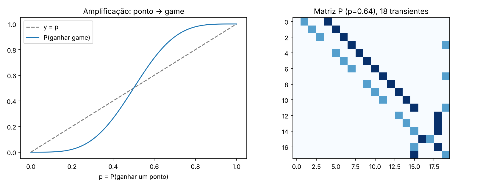

# How much is one extra point on serve worth? A Markov chain model of a tennis game

**A tennis service game modelled as an absorbing Markov chain, solved exactly and tested against real point-by-point data from professional matches.**

**Key results** (p = 0.642, the share of points won on serve in the data)
- Winning **64.2% of points** on serve becomes winning **81.6% of service games**: the game structure amplifies small edges.
- Each extra percentage point of points won on serve is worth about **1.7 percentage points** of service games held (derivative of the win probability, G′(0.642) = 1.73).
- A game lasts **6.24 points** on average (sd 2.41) and **never 7, 9 or 11 points**: the deuce cycle makes the chain periodic with period 2.
- Tested on the [Match Charting Project](https://github.com/JeffSackmann/tennis_MatchChartingProject) (860,213 points, 140,310 games, 5,516 men's professional matches): **81.6% predicted vs 80.1% observed** service games held; with each player's own p, 79.8%. No real game lasted 7, 9 or 11 points.
- Extension: the same chain stacked into sets and matches shows how a 0.04 edge per point becomes a 69% chance of winning a best-of-3 match.

**Skills shown:** stochastic processes, linear algebra (fundamental matrix N = (I − Q)⁻¹, absorption probabilities B = NR, expected absorption times), sensitivity analysis, Python (NumPy, Matplotlib), validation of a model against real data.



*Team project (4 students) for Processos Estocásticos e Filas de Espera, University of Aveiro, November 2026. My parts: the transition matrix and its canonical form, absorption probabilities and time to absorption.*

---

## The model

- **States (20):** the 16 scores from 0-0 to 40-40, Advantage server, Advantage receiver, and the two absorbing states Game server and Game receiver.
- **Assumptions:** points are independent and the server wins each one with the same probability p.
- **Canonical form:** P = [Q R; 0 I], with Q the 18 × 18 block of transient states. The fundamental matrix N = (I − Q)⁻¹ gives the expected visits to each state; B = NR the probability of each final result; t = N·1 the expected number of points left.

| From the score | P(server wins the game) | Expected points left |
|:--|:-:|:-:|
| 0-0 | 0.816 | 6.24 |
| 15-0 | 0.897 | 4.87 |
| 0-15 | 0.672 | 5.91 |
| 40-0 | 0.989 | 1.66 |
| Deuce (40-40) | 0.763 | 3.70 |
| 0-40 | 0.202 | 3.03 |

*Computed with `python tenis_markov.py --p 0.642`.*



## Files

| File | What it does |
|:--|:--|
| `tenis_markov.py` | Builds the 20 × 20 transition matrix, solves the chain (N, B, t), checks it against the closed formula, extends it to sets and matches, and draws `figuras_tenis.png` |
| `diagramas_tenis.py` | Draws the transition graph, the canonical matrix and a summary of the chain's properties |
| `obter_dados_charting.py` | Downloads the Match Charting Project files into `dados_charting/` |
| `analise_charting.py` | Rebuilds every real game point by point, estimates p and compares observed and predicted holds and game lengths |
| `figures/` | The figures produced by the scripts |

Code comments are in Portuguese (the course language).

## How to run it

```
python -m pip install -r requirements.txt
python tenis_markov.py --p 0.642     # the chain (default p = 0.64)
python diagramas_tenis.py            # the diagrams
python obter_dados_charting.py       # downloads the real data (~100 MB)
python analise_charting.py           # validation with real data
```

## Limitations

- Points are assumed independent with a constant p; in reality pressure, fatigue and first vs second serve matter, although the deviations are small (Klaassen and Magnus, 2001).
- A single p for all players; using each player's p improves the fit.
- Data: men's professional matches only.

## References

- Match Charting Project, Jeff Sackmann (CC BY-NC-SA 4.0). The data are not included in this repository; `obter_dados_charting.py` downloads them.
- J. G. Kemeny and J. L. Snell, *Finite Markov Chains*, 1960.
- F. J. G. M. Klaassen and J. R. Magnus, "Are points in tennis independent and identically distributed?", *JASA* 96 (2001).
- P. K. Newton and J. B. Keller, "Probability of winning at tennis I. Theory and data", *Studies in Applied Mathematics* 114 (2005).
